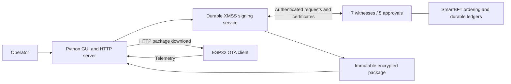
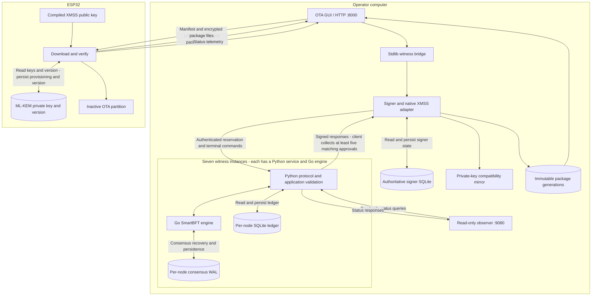
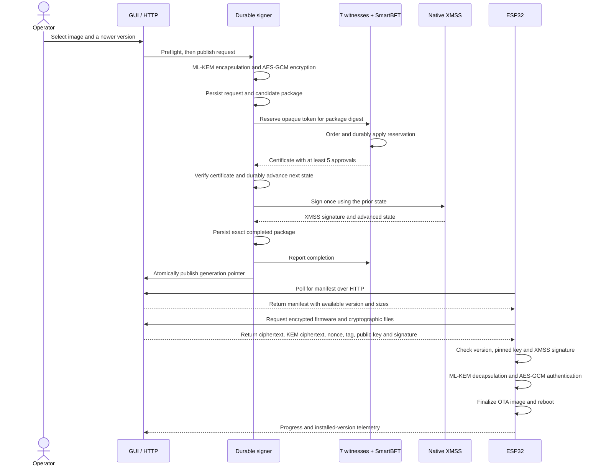
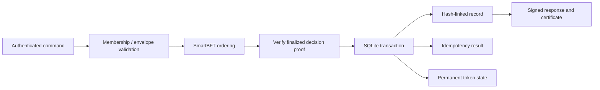
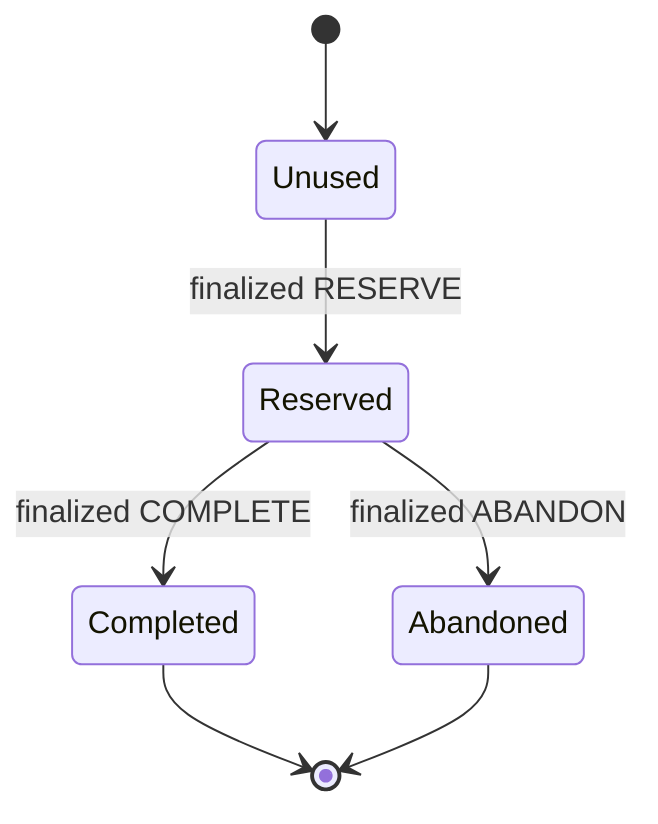
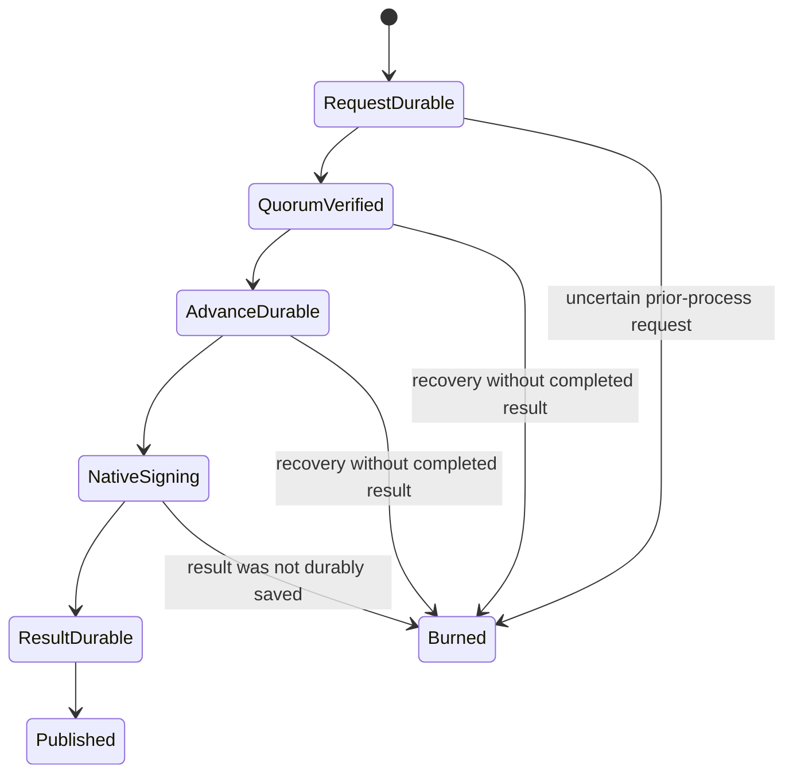

# Quantum-Safe and Trust-Adaptive Firmware Update Framework for IoT Devices

An ESP32 firmware-update research project combining **XMSS signatures**, **ML-KEM-768 key establishment**, **AES-256-GCM encryption**, and a **five-of-seven witness authorization service**. A Windows Python application publishes updates and displays device telemetry. Seven Python witnesses use a Go/Hyperledger SmartBFT engine to order signing reservations and keep a certified, persistent ledger.

The two source folders form one project. Keep their names and sibling relationship when moving the containing folder.

## Contents

- [Project overview](#what-the-project-does)
- [Repository layout](#repository-layout)
- [Source file reference](#source-file-reference)
- [Quick start](#run-an-already-provisioned-deployment)
- [Complete architecture and diagrams](#complete-architecture)
- [Setup and operation](#setup-and-operation)
- [Fresh installation](#fresh-installation)
- [Verification and tests](#verification-and-tests)
- [Troubleshooting](#troubleshooting)
- [Optional synthetic Docker deployment](#optional-synthetic-docker-deployment)
- [Third-party notices](#third-party-notices)

## What the project does

1. The ESP32 generates an ML-KEM device keypair; its private key remains in NVS.
2. An operator selects an application image and a strictly newer package version.
3. The host encapsulates to the enrolled device public key and encrypts the image with AES-GCM.
4. The signer requests a reservation for the next one-time signing position. It requires five verified witness approvals.
5. The signer durably advances its XMSS state, signs the package digest once, and stores the exact result for retries.
6. The server publishes an immutable package generation.
7. The ESP32 checks the pinned publisher key and XMSS signature, decapsulates the encryption key, authenticates/decrypts the image, and installs it in its OTA partition.
8. Device telemetry reports progress, rejection reasons, installation and reboot status.



## Repository layout

The tree below lists all checked-in project files, including the C cryptographic sources and headers. The third-party SmartBFT subtree is collapsed because it contains upstream source, tests and dependencies. Generated files and private deployment state are excluded.

```text
.
├── Ota_project/
│   ├── applications/
│   │   └── ota-system/
│   │       ├── core/
│   │       │   ├── __init__.py  # Python package marker
│   │       │   ├── ota_collection.py  # Retained development data collection support
│   │       │   ├── ota_conditions.py  # Development scenario and condition support
│   │       │   ├── ota_experiment.py  # Retained experiment orchestration support
│   │       │   ├── ota_witness_bridge.py  # Signer subprocess API and immutable package access
│   │       │   ├── paths.py  # Shared OTA application paths
│   │       │   ├── telemetry.py  # Thread-safe telemetry snapshots and persistence
│   │       │   └── trust_model.py  # Advisory readiness and availability model
│   │       ├── esp32_ota_hybrid/
│   │       │   ├── src/
│   │       │   │   ├── device_stress_test.h  # Optional ESP32 RAM/CPU stress testing
│   │       │   │   ├── main.cpp  # ESP32 firmware download, verification and installation
│   │       │   │   ├── network_config.example.h  # Example network configuration
│   │       │   │   └── xmss_trusted_key.h  # Pinned publisher XMSS public key
│   │       │   ├── partitions.csv  # ESP32 flash and OTA partition layout
│   │       │   └── platformio.ini  # ESP32 build and library configuration
│   │       ├── trust_artifacts/
│   │       │   ├── dataset.csv  # Retained advisory-model development dataset
│   │       │   ├── evaluation.json  # Retained model evaluation results
│   │       │   ├── excluded_attempts.json  # Retained excluded development attempts
│   │       │   ├── model.json  # Advisory model parameters
│   │       │   └── REPORT.md  # Retained advisory-model development report
│   │       ├── mlkem_encapsulate.c  # Legacy liboqs encapsulation helper
│   │       ├── requirements.txt  # Python dependencies for this component
│   │       ├── run_gui.cmd  # Launch the OTA GUI in its local Python environment
│   │       ├── save_mlkem_public_key.py  # Extract device public key from serial output
│   │       ├── xmss_ota_gui.py  # Operator GUI, HTTP package server and telemetry
│   │       └── xmss_signer_python.py  # Witness-backed publishing CLI entry point
│   ├── crypto-libs/
│   │   ├── fips202/
│   │   │   ├── src/
│   │   │   │   ├── fips202.c
│   │   │   │   └── fips202.h
│   │   │   └── library.json  # PlatformIO library metadata
│   │   ├── mlkem768/
│   │   │   ├── src/
│   │   │   │   ├── mlkem_native/
│   │   │   │   │   ├── cbmc.h
│   │   │   │   │   ├── common.h
│   │   │   │   │   ├── compress.c
│   │   │   │   │   ├── compress.h
│   │   │   │   │   ├── debug.c
│   │   │   │   │   ├── debug.h
│   │   │   │   │   ├── indcpa.c
│   │   │   │   │   ├── indcpa.h
│   │   │   │   │   ├── kem.c
│   │   │   │   │   ├── kem.h
│   │   │   │   │   ├── mlkem_native_config.h
│   │   │   │   │   ├── params.h
│   │   │   │   │   ├── poly.c
│   │   │   │   │   ├── poly.h
│   │   │   │   │   ├── poly_k.c
│   │   │   │   │   ├── poly_k.h
│   │   │   │   │   ├── randombytes.h
│   │   │   │   │   ├── sampling.c
│   │   │   │   │   ├── sampling.h
│   │   │   │   │   ├── symmetric.h
│   │   │   │   │   ├── sys.h
│   │   │   │   │   ├── verify.c
│   │   │   │   │   ├── verify.h
│   │   │   │   │   └── zetas.inc
│   │   │   │   └── arduino_fips202.h  # Connect embedded ML-KEM to shared SHA-3/SHAKE
│   │   │   └── library.json  # PlatformIO library metadata
│   │   └── xmss/
│   │       ├── src/
│   │       │   ├── Makefile
│   │       │   ├── XMSS_commons.c
│   │       │   ├── XMSS_commons.h
│   │       │   ├── XMSS_config.h
│   │       │   ├── XMSS_core_fast.c
│   │       │   ├── XMSS_core_fast.h
│   │       │   ├── XMSS_hash.c
│   │       │   ├── XMSS_hash.h
│   │       │   ├── XMSS_hash_address.c
│   │       │   ├── XMSS_hash_address.h
│   │       │   ├── XMSS_hash_wrapper.c
│   │       │   ├── XMSS_params.h
│   │       │   ├── XMSS_randombytes.c
│   │       │   ├── XMSS_randombytes.h
│   │       │   ├── XMSS_sha256.c
│   │       │   ├── XMSS_sha256.h
│   │       │   ├── XMSS_utils.h
│   │       │   ├── XMSS_wots.c
│   │       │   ├── XMSS_wots.h
│   │       │   ├── XMSS_xmss.c
│   │       │   └── XMSS_xmss.h
│   │       └── library.json  # PlatformIO library metadata
│   └── .gitignore  # Exclude local state and generated files
├── witness-quorum/
│   ├── engine/
│   │   ├── go.mod  # Go module and dependency declarations
│   │   ├── go.sum  # Go dependency checksums
│   │   └── main.go  # Go adapter for SmartBFT ordering and decision verification
│   ├── native/
│   │   └── xmss_advance.c  # No-signature XMSS state-advance adapter
│   ├── scripts/
│   │   ├── bootstrap.ps1  # Prepare local toolchains and Python dependencies
│   │   ├── build.ps1  # Build native XMSS components and the Go engine
│   │   ├── enroll_ota.py  # Enroll the OTA publisher/device connection
│   │   ├── integration.py  # Witness integration and fault-scenario checks
│   │   ├── make_compose.py  # Generate synthetic Docker deployment configuration
│   │   ├── observer.ps1  # Launch the witness observer
│   │   ├── provision_fresh.py  # Provision a fresh publisher and witness deployment
│   │   ├── restart-observer.ps1  # Restart the witness observer
│   │   ├── start.ps1  # Start the native witness deployment
│   │   ├── stop.ps1  # Stop the native witness deployment
│   │   └── test_ota_integration.py  # OTA publishing integration checks
│   ├── tests/
│   │   ├── test_adversarial.py  # Regression tests: adversarial
│   │   ├── test_core.py  # Regression tests: core
│   │   ├── test_deployment.py  # Regression tests: deployment
│   │   ├── test_manifest_interop.py  # Regression tests: manifest interop
│   │   └── test_native.py  # Regression tests: native
│   ├── vendor-source/
│   │   └── SmartBFT/  # Pinned upstream Go source, tests and vendored dependencies (subtree omitted)
│   ├── witness/
│   │   ├── __init__.py  # Python package marker
│   │   ├── checkpoint.py  # Export and verify certified historical prefixes
│   │   ├── client.py  # Authenticated witness client and request submission
│   │   ├── codec.py  # Witness command and record encoding
│   │   ├── crypto.py  # Cryptographic helpers, identities and token derivation
│   │   ├── dashboard.py  # Read-only witness observer dashboard
│   │   ├── deployment.py  # Resolve the active deployment directory
│   │   ├── local.py  # Manage local witness processes
│   │   ├── native.py  # Python interface to native XMSS functions
│   │   ├── node.py  # Witness service and local Go-engine bridge
│   │   ├── ota_signer.py  # Durable XMSS state, recovery and package publication
│   │   ├── proof.py  # Authorization and consensus evidence verification
│   │   ├── setup.py  # Provision witness identities and genesis configuration
│   │   ├── store.py  # SQLite ledger transactions and replay audit
│   │   └── transport.py  # Authenticated experimental witness transport
│   ├── .dockerignore  # Exclude local files from Docker build context
│   ├── .gitignore  # Exclude local state and generated files
│   ├── ARCHITECTURE.md  # Earlier witness-ledger design reference
│   ├── compose.yaml  # Synthetic Docker deployment services
│   ├── Dockerfile  # Synthetic witness container image
│   ├── IMPLEMENTATION.md  # Implemented witness behavior and boundaries
│   ├── requirements.lock  # Pinned witness Python dependency versions
│   └── requirements.txt  # Python dependencies for this component
├── .gitattributes  # Repository text and line-ending rules
├── .gitignore  # Exclude local state and generated files
└── README.md  # Project overview, setup, architecture and operation
```

Provisioned machines also contain ignored `runtime/`, `.venv/`, `.tools/`, compiled binaries, keys, package files and telemetry. These are local operational resources, not committed to the source repository.

## Source file reference

All project setup and operating documentation is in this README. The files below implement the individual components.

| Path | Role |
| --- | --- |
| `Ota_project/applications/ota-system/xmss_ota_gui.py` | Publishing controls, threaded HTTP server, telemetry and activity logs |
| `Ota_project/applications/ota-system/xmss_signer_python.py` | CLI entry point delegating publication to the required witness signer |
| `Ota_project/applications/ota-system/core/ota_witness_bridge.py` | Connection validation, subprocess API and immutable package reads |
| `Ota_project/applications/ota-system/core/telemetry.py` | Thread-safe memory snapshots and atomic telemetry persistence |
| `Ota_project/applications/ota-system/core/trust_model.py` | Advisory readiness/availability model |
| `Ota_project/applications/ota-system/core/ota_collection.py`, `ota_conditions.py`, `ota_experiment.py` | Retained collection/scenario support; normal GUI does not enable research runs |
| `Ota_project/applications/ota-system/trust_artifacts/` | Advisory model and retained development/evaluation artifacts |
| `Ota_project/applications/ota-system/run_gui.cmd` | Launch the project-local OTA Python environment |
| `Ota_project/applications/ota-system/save_mlkem_public_key.py` | Extract the recipient public key from device serial output |
| `Ota_project/applications/ota-system/mlkem_encapsulate.c` | Legacy liboqs helper source; not required by normal witness-backed publishing |
| `Ota_project/crypto-libs/mlkem768/src/arduino_fips202.h` | Maps embedded ML-KEM operations to the shared FIPS 202 implementation |
| `witness-quorum/witness/ota_signer.py` | Authoritative XMSS state, crash recovery, exact retries and immutable publication generations |
| `witness-quorum/witness/store.py` | Per-witness SQLite transactions and certified-history replay audit |
| `witness-quorum/witness/proof.py` | Offline verification of authorization and consensus evidence |
| `witness-quorum/witness/deployment.py` | Resolves the active deployment relative to the project |
| `witness-quorum/engine/main.go` | Go adapter connecting the witness application to SmartBFT |
| `witness-quorum/native/xmss_advance.c` | Exposes a no-signature BDS transition using the shared XMSS core |
| `witness-quorum/tests/` | Reusable regression and adversarial tests with disposable fixtures |

Third-party README and license files remain inside the vendored dependency source. They describe upstream libraries rather than this project's setup.

## Run an already-provisioned deployment

From the combined project root in PowerShell:

```powershell
.\witness-quorum\scripts\start.ps1
```

The start script changes PowerShell's working directory to `witness-quorum`. Return to the combined root, then open the GUI:

```powershell
Set-Location ..
.\Ota_project\applications\ota-system\run_gui.cmd
```

Use **Check signer**, select a compatible application image and a newer version, then **Sign and publish**. The ESP32 must be on a network that can reach the host on TCP 8000. Observe witnesses at [localhost:9080](http://127.0.0.1:9080).

**A fresh source checkout is not provisioned.** Follow [the fresh setup guide](#fresh-installation) before using these commands. Do not run fresh provisioning on an existing publisher.

## Software and hardware

| Component | Project configuration |
| --- | --- |
| Operator host | Windows and PowerShell; Python 3.12 with Tkinter |
| C compiler | GCC available as `gcc` (tested with MSYS2 UCRT64) |
| Consensus engine | Go 1.27.3, pinned in `engine/go.mod`; bootstrap installs a local toolchain |
| Device tooling | PlatformIO with Espressif32/Arduino support |
| Device | ESP32 development board, 4 MB flash, USB cable and Wi-Fi |
| Witness Python packages | Pinned in `witness-quorum/requirements.lock` |
| OTA GUI packages | Pinned in `Ota_project/applications/ota-system/requirements.txt` |

The host's normal witness-backed publishing path uses `pqcrypto` and `cryptography` inside the witness environment. The old liboqs command-line helper is not needed for that path.

## Cryptographic roles

| Mechanism | Purpose |
| --- | --- |
| XMSS mode 1 | Firmware authenticity: height-10 SHA-256 profile with stateful one-time positions |
| ML-KEM-768 | Establish the firmware encryption key with the device; also used in the experimental witness channel |
| AES-256-GCM | Firmware confidentiality/integrity and authenticated witness-channel records |
| ML-DSA-65 | Witness/client identities and signatures on protocol/consensus evidence |
| SHA-256 | Package digest, hash-linked ledger and protocol commitments |
| SHA-3/SHAKE | Shared FIPS 202 primitives, notably for embedded ML-KEM and optional XMSS profiles |

XMSS mode 1 has 1,024 theoretical leaves; this implementation reserves the final leaf and refuses signing at next index 1023. Failed or uncertain operations can burn positions. Rebuilding a DLL does not reset the index. Reusing or restoring an old private-key state can destroy the one-time-signature safety property.

## Validation overview

Tests are useful source code and are retained. Generated test directories, caches and disposable deployments are excluded from GitHub. See [testing instructions](#verification-and-tests) for commands and cleanup, including the distinction between unit tests and integration tests that pause the running quorum.

A signer preflight checks availability without publishing a firmware release. A full live OTA operation consumes signing state; it is not a disposable smoke test.

## Scope and limitations

- The five-of-seven gate is enforced at the **host signer**. The current ESP32 verifies XMSS and AEAD but does not independently validate witness certificates.
- Seven local processes demonstrate quorum behavior but share one computer, disk and administrative trust domain.
- The witness transport is an experimental custom protocol, not standard TLS or an independently reviewed secure-channel implementation.
- Opaque tokens hide the raw XMSS index from witness commands, but witnesses cannot prove that a malicious signer derived the correct token for an index.
- Status/height are advisory observations, not fresh authorization or a general recovery barrier.
- Docker describes a separate synthetic witness deployment. Its configuration exists, but this project's operating workflow is the native Windows deployment.
- The readiness model is advisory in normal GUI operation. It is not a security authorization mechanism.
- This is a research prototype; independent security review, independent witness hosts and stronger rollback protection remain future work.

No project-wide open-source license has been selected here. Retain upstream notices and choose a license for your own code before offering explicit reuse terms.


## Complete architecture

This section describes the checked-in implementation. `witness-quorum/ARCHITECTURE.md` is an earlier design reference; when it differs, this guide and `witness-quorum/IMPLEMENTATION.md` describe the implemented boundaries.

### Components and trust boundaries



The publisher key is a trust anchor compiled into the device. The witness genesis and administrator public key pin membership and publisher registration. Witness private identities are separate from the XMSS publisher key.

The witness box represents seven instances of the illustrated Python/Go pair, each with its own ledger and consensus WAL. All seven run on the same operator computer in the native deployment and share its administrative and physical failure domain; the box does not represent seven independent host trust boundaries. The signer's Python client verifies matching signed responses and assembles the authorization certificate from at least five distinct witnesses. The ESP32 verifies the publisher signature and encrypted package, but does not independently enforce the witness certificate.

### Release sequence



Completion reporting is retried if uncertain. Publishing is tied to stored completed results; exact retries return the stored signature/ciphertext rather than signing again.

The ESP32 initiates the HTTP requests; the GUI's HTTP server responds with the manifest and package files. The device then verifies and installs the update.

### Package construction and verification

The host encapsulates to the 1,184-byte ML-KEM-768 recipient public key. The resulting shared secret is used as the AES-256-GCM key with a fresh 12-byte nonce. The ML-KEM ciphertext is 1,088 bytes and the GCM tag is 16 bytes.

The package digest binds the protocol domain, version and lengths, encrypted firmware digest, KEM ciphertext, nonce and tag. XMSS signs this 32-byte digest. This profile uses a 64-byte XMSS public key and a 2,500-byte signature, including the signing index.

| File | Meaning |
| --- | --- |
| `manifest.json` | Ordered JSON containing `version`, plaintext `size`, and `encrypted_size` |
| `firmware.bin` | AES-GCM ciphertext, not an unencrypted application binary |
| `firmware.kem` | ML-KEM ciphertext needed for device decapsulation |
| `firmware.nonce`, `firmware.tag` | GCM nonce and authentication tag |
| `firmware.pub`, `firmware.sig` | Publisher public key and XMSS signature |
| `firmware.witness.json` | Host authorization certificate retained with the package |

The ESP32 hashes the encrypted firmware, reconstructs the digest, checks its pinned public key and verifies XMSS before decapsulation. It then streams authenticated decryption into the update workflow and finalizes only after the GCM tag check. It does not currently enforce `firmware.witness.json` itself.

The server pins a package generation per client address when serving the manifest. Subsequent files come from that generation, avoiding a mixture of files from two releases. The immutable directory is authoritative; adjacent top-level package files are compatibility mirrors.

### Quorum and ledger

There are seven registered witnesses. Five verified approvals are required for authorization. The SmartBFT engine handles ordering, leader selection/change and durable consensus WAL. Each Python witness independently validates commands and applies finalized decisions to its own SQLite database.



Token lifecycle:



A completed or abandoned token never becomes unused. Exact repeated requests return their original result. A conflicting request cannot reuse a consumed token. Enrollment of an existing key can import already-consumed positions as permanently abandoned tokens.

**Leader** identifies the witness coordinating proposals; it still needs quorum approval. **Height** counts accepted application records. A successful update generally creates reservation and completion records. Height, package version, consensus slot and XMSS next index are different counters. Rejected finalized commands can advance consensus slots without adding application records.

On database open, the witness verifies retained decision proofs and replays history to audit derived tables. Certified state transfer pages decisions rather than trusting an arbitrary leader snapshot. This detects inconsistencies relative to the retained history, but cannot by itself prevent replacement of an entire deployment with an older valid copy.

### XMSS crash handling

The authoritative state is `runtime/ota/signer/state.sqlite`. `xmss_private.key` is a compatibility mirror, not an independent signer.



The signer commits the advanced BDS state before invoking the one-time signature on the prior state. Recovery burns incomplete positions instead of risking reuse. Native signing is serialized by an exclusive lock; durable journal entries support retries and completion/abandonment reporting. Replacing a DLL changes implementation code, not persisted state.

Never restore a private key alone, merge two independently advanced signer databases, reset the ledger, or run two copied publishers concurrently. A deployment move requires stopping writers and preserving signer state, key mirrors, all witness databases and consensus WAL together.

### Storage map

| Location | Role | Committed to GitHub? |
| --- | --- | --- |
| `witness-quorum/runtime/ota/genesis.json`, `admin.pub` | Pinned deployment identity | No: deployment-specific |
| `runtime/ota/secrets/` | Witness, client and administrator private keys | Never |
| `runtime/ota/data/node-N/` | Per-witness ledger SQLite and engine WAL | No |
| `runtime/ota/signer/state.sqlite` | Authoritative publisher state and operation journal | Never |
| `runtime/ota/publications/` | Exact completed package generations | No |
| OTA `xmss_private.key` | Compatibility private-key mirror | Never |
| OTA `witness-connection.json` | Relative connection to deployed signer | No |
| OTA `witness-publication.json` | Current immutable generation pointer | No |
| `src/network_config.local.h` | Local Wi-Fi credentials and server address | Never |
| `src/xmss_trusted_key.h` | Public verification anchor compiled into firmware | Yes: public data; fresh setup replaces it |
| `trust_artifacts/model.json` | Advisory runtime model | Yes |

Connection and publication paths resolve relative to the OTA application folder. The active deployment pointer resolves relative to `runtime/`. Signer journal directory paths resolve relative to its deployment.

### Networking

| Port | Listener | Access |
| --- | --- | --- |
| TCP 8000 | OTA HTTP server | ESP32 must reach the host LAN address |
| TCP 9080 | Read-only observer | Localhost |
| TCP 9101–9107 | Authenticated native witness endpoints | Native local deployment |
| TCP 10101–10107 | SmartBFT engine HTTP endpoints | Loopback bridge, bearer authenticated |
| TCP 11101–11107 | Python application bridge endpoints | Loopback, bearer authenticated |

Witness peer/client requests use a fresh ephemeral ML-KEM handshake, ML-DSA identities, transcript-bound HKDF-SHA256 and directional AES-GCM records. Sessions carry one bounded request/response, reject replay and close. Frame size is bounded at 4 MiB. This is an experimental application protocol, not a claim of TLS equivalence.

### Telemetry and advisory model

The ESP32 reports stage, installed version, uptime, memory, Wi-Fi RSSI/reconnects, HTTP counters and OTA timing. The GUI maintains a thread-safe memory snapshot and local disk history. The model derives windowed availability/readiness features and displays an advisory result. Normal serving does not withhold the manifest based on this model. Collection/scenario support remains in `core/`, but the removed research GUI and experiment directories are not part of this source tree.

### Deployment limits

The device's XMSS public-key pin authenticates the publisher, not a witness quorum certificate. A compromised host signer is outside the strongest intended authorization boundary. Witness tokens have trusted derivation, not a zero-knowledge proof of index correspondence. Local seven-process deployment has a shared failure domain. Hardware anti-rollback, independent witness hosts, membership reconfiguration and independent security review are outside the current implementation.


## Setup and operation

Commands below use Windows PowerShell and start from the combined project root unless a step says otherwise. Keep `Ota_project` and `witness-quorum` as siblings. Avoid running a second copy of the publisher or an old standalone witness deployment.

### Existing provisioned computer

Do not generate keys, run fresh provisioning or delete `runtime/` for normal startup.

```powershell
.\witness-quorum\scripts\start.ps1
# start.ps1 changes the current directory to witness-quorum
.\.venv\Scripts\python.exe -B -m witness.client status
.\.venv\Scripts\python.exe -B -m witness.ota_signer preflight --config ..\Ota_project\applications\ota-system\witness-connection.json
Set-Location ..
.\Ota_project\applications\ota-system\run_gui.cmd
```

The seven statuses should become reachable and eventually agree on height and tip. At least five with a selected leader must be available for signing. Preflight checks key consistency and witness availability without creating a signature. If a private-key mirror is behind the authoritative journal, preflight may repair that mirror; it does not allocate a new index.

The observer is at [http://127.0.0.1:9080](http://127.0.0.1:9080). It is advisory and read-only. Closing the PowerShell window does not stop the witnesses. Rebooting does; run the start script afterward.

### Fresh installation

Clone the repository and enter its root folder before following the setup steps:

```powershell
git clone https://github.com/connect-nasar/Quantum-Safe-and-Trust-Adaptive-Firmware-Update-Framework-for-IoT-Devices.git
Set-Location Quantum-Safe-and-Trust-Adaptive-Firmware-Update-Framework-for-IoT-Devices
```

A source checkout intentionally contains no private keys, witness identities, ledgers, deployed connection files, recipient key or built executables. Use the following steps only for a **new publisher and device trust setup**. The fresh provisioner refuses an existing publisher/deployment rather than resetting it.

#### 1. Install tools

- Python 3.12, including Tkinter and `venv`.
- Git, for repository operations.
- GCC on `PATH`; the Windows build uses `-lbcrypt` for the OS random provider.
- PlatformIO, for the ESP32 build and USB upload.
- A USB driver/cable appropriate for the ESP32 board.

Check the executables:

```powershell
python --version
gcc --version
git --version
python -m platformio --version
```

If PlatformIO is not installed in your selected Python environment:

```powershell
python -m pip install platformio
```

#### 2. Create the OTA GUI environment

```powershell
python -m venv .\Ota_project\.venv
.\Ota_project\.venv\Scripts\python.exe -m pip install -r .\Ota_project\applications\ota-system\requirements.txt
```

The GUI and witness environments are separate because their locked dependency profiles differ.

#### 3. Build the witnesses and native XMSS library

```powershell
.\witness-quorum\scripts\bootstrap.ps1
```

The script changes directory to `witness-quorum`, creates its Python environment, installs `requirements.lock`, installs a pinned Go 1.27.3 toolchain under `.tools/` if missing, verifies the downloaded Go archive hash, builds `bin/witness-engine.exe`, and builds `bin/witness_xmss.dll` from the shared C sources. Initial tool installation needs internet access. GCC must already be installed.

Build outputs are ignored by Git and rebuilt locally. Go uses the vendored SmartBFT source through the `replace` directive in `engine/go.mod`; retain that directory in the source distribution.

#### 4. Provision a new publisher

Still in `witness-quorum`:

```powershell
.\.venv\Scripts\python.exe -B .\scripts\provision_fresh.py
```

This generates a new XMSS key, seven witness identities, an administrator identity and a client registration. It provisions genesis, enrolls the signer at next index zero, writes relative connection pointers, and updates the ESP32's compiled public-key header. It does **not** sign firmware or start services.

Run once. If setup stops partway through, retain all generated files and inspect the error. Do not repeatedly delete state or force replacement. This command is not an upgrade, recovery or rotation tool.

For importing an already-used publisher, `scripts/enroll_ota.py` is a separate administrative workflow: it checks an existing signed package and imports already-consumed positions. Do not use it to replace the existing deployment.

#### 5. Configure Wi-Fi and the OTA server

Return to the combined root:

```powershell
Set-Location ..
Copy-Item .\Ota_project\applications\ota-system\esp32_ota_hybrid\src\network_config.example.h .\Ota_project\applications\ota-system\esp32_ota_hybrid\src\network_config.local.h
```

Edit `network_config.local.h` with your Wi-Fi SSID/password and the host computer's LAN IPv4 address. Use the address reachable from the ESP32, not `127.0.0.1`. The file is ignored and excluded from Git. If it is missing, compilation uses placeholder values from the example, which must be replaced for a working network connection.

Allow incoming TCP 8000 for this host application on the intended private network. The GUI binds to all interfaces; the observer remains localhost-only. Witness internals should not be exposed directly to the public internet.

#### 6. Build and USB-flash the ESP32

```powershell
Set-Location .\Ota_project\applications\ota-system\esp32_ota_hybrid
python -m platformio run
python -m platformio run --target upload
python -m platformio device monitor --baud 115200
```

If needed, select the serial device using PlatformIO's `--upload-port COMx` or monitor `--port COMx` options. The default environment is `esp32dev`; flash size is 4 MB, with two `0x1E0000` application slots. Keep `partitions.csv` compatible with the installed device.

Fresh provisioning changed the XMSS trust anchor. The first USB-flashed image must contain that key before it can accept OTA packages from the new publisher. Subsequent application images must retain the same key, network configuration and OTA partition layout unless you deliberately implement a migration.

Do not erase NVS during ordinary firmware updates: it contains the device ML-KEM private key and installed-version state.

#### 7. Enroll the device recipient public key

On first boot the device generates its ML-KEM keypair and prints the public key as hexadecimal lines. Save the relevant serial output into `device_serial.log` in `applications/ota-system`, then run from that folder:

```powershell
..\..\.venv\Scripts\python.exe -B .\save_mlkem_public_key.py .\device_serial.log .\mlkem_device.pub
```

The script extracts the 1,184-byte public key. Keep it beside the OTA entry points. The private key stays on the ESP32. If the device's NVS key is deliberately replaced, re-enroll its public key before publishing another image.

#### 8. Start services and publish

Return to the combined root and use the existing-deployment startup sequence above. In the GUI:

1. Wait for healthy device telemetry and use **Check signer**.
2. Select the application image from `.pio/build/esp32dev/firmware.bin`, not `bootloader.bin` or `partitions.bin`.
3. Choose a version strictly greater than both the published and device-installed versions. The GUI suggests a suitable value.
4. Use **Sign and publish** once. Each new signing operation consumes an XMSS position; retry the exact operation rather than inventing a different request after uncertainty.
5. Observe download, signature verification, installation and post-reboot telemetry.

The host stores the selected plaintext as `input_firmware.bin`; the served `firmware.bin` is encrypted. Publishing changes the manifest and immutable generation pointer. It does not USB-flash the board.

### Shutdown

Close the GUI to stop its HTTP server. Stop the tracked witnesses and observer from the combined root:

```powershell
.\witness-quorum\scripts\stop.ps1
```

Stop/start preserves keys, ledgers and signing indices. Do not delete SQLite/WAL files to force a restart or recover signing capacity.

### Rebuilding libraries

From `witness-quorum`:

```powershell
.\.venv\Scripts\python.exe -B -m witness.native
.\scripts\build.ps1
```

Do this with publishing idle and services stopped if replacing loaded files. The normal witness-backed signer uses `bin/witness_xmss.dll`. The legacy host binding can rebuild `xmss_lib.dll` when loaded; both consume the shared `crypto-libs/xmss` and `crypto-libs/fips202` source. Rebuilding code does not generate a new private key or change its index.

The FIPS source filenames are `fips202.c` and `fips202.h`; declarations/callers use the renamed SHAKE functions. Do not reintroduce old cached library copies. PlatformIO resolves all embedded libraries from `crypto-libs` through `lib_extra_dirs`.

The shared XMSS C API includes `xmss_keypair`, `xmss_sign`, `xmss_sign_open` and `xmss_xmssmt_core_sk_bytes`. XMSSMT-specific entry points use `xmssmt_`; compile-time configuration selects the profile. Mode 1 uses n=32, h=10, D=1 and WOTS+ w=16.

For a standalone static library, run `make XMSS_MODE=1` from `Ota_project/crypto-libs/xmss/src` in a make-compatible environment. It builds `libxmss.a`. This is optional for the normal witness/PlatformIO workflow. Object files and archives are disposable build output; key state and signatures are not changed by compiling them.

The PlatformIO environment `journal_stress` is an optional device stress build, selected with `python -m platformio run -e journal_stress`. Normal firmware uses the default `esp32dev` environment.

### Verification and tests

From `witness-quorum`, reusable tests can run with disposable temporary state:

```powershell
.\.venv\Scripts\python.exe -B -m pytest tests -q -p no:cacheprovider --basetemp .test-tmp
# Remove only the generated scratch directory after tests finish.
Remove-Item -LiteralPath .\.test-tmp -Recurse -Force
```

Some transport tests open localhost sockets. Native tests generate disposable XMSS keys and may take longer. Saved-history checks can skip when historical local reports are absent from a fresh clone. No test key should be substituted for the deployed publisher.

The real OTA integration campaign uses a disposable host/key/deployment but temporarily pauses the active witnesses:

```powershell
.\.venv\Scripts\python.exe -B .\scripts\test_ota_integration.py --allow-live-pause
```

Run only with no active publishing and after reading that script. It restores the previous witness services afterward and writes local evidence into `reports/`. This is optional development validation, not a startup step. `scripts/integration.py` is the older synthetic witness campaign and refuses to run against the active OTA deployment.


### Troubleshooting

| Symptom | What to check |
| --- | --- |
| Fewer than five witnesses reachable | Start this project's services; check `runtime/ota/node-N.log`, port conflicts and leader election |
| Services are healthy only when an old folder is running | Inspect process command lines: `--root` and engine path must refer to this project; do not run both deployments |
| Port 8000 in use | Close the other GUI/server before starting another |
| Device has no telemetry | Wi-Fi configuration, host LAN address, firewall and HTTP port |
| Publisher-key rejection | The USB-flashed trust anchor must match the enrolled signer public key |
| ML-KEM/GCM failure | Correct device public-key enrollment, intact package, unchanged NVS recipient key |
| Same/older version rejected | Publish a higher version; do not reset stored version to bypass rollback checks |
| Signer/mirror mismatch or index regression | Stop publishing and reconcile authoritative state; do not generate a replacement key under the same publisher |
| GCC or DLL error | Ensure GCC is on PATH and rebuild the native adapter from this source tree |
| Missing witness connection on fresh checkout | Complete fresh provisioning and device enrollment |
| Missing Python environment after moving computers | Recreate `.venv` from requirements; generated virtual environments are machine-specific |

### Backups and moves

For private operational backups, stop publishing and all services first. Preserve the signer journal, key mirror, all seven witness databases and engine WAL, genesis/admin pins, identities, connection pointers and immutable generations as one consistent deployment. A source repository is not such a private deployment backup.

After moving the combined folder, use its own scripts. The seven service paths must point into the moved project. Do not trust a copied PID file as proof that the correct service is running, and never start old and new copies concurrently. Do not restore older state under the same XMSS publisher merely because it starts successfully.


### Optional synthetic Docker deployment

This profile provisions a separate synthetic witness network, not the native OTA publisher. Docker must be installed with its Linux engine running. From `witness-quorum`:

```powershell
.\.venv\Scripts\python.exe -B -m witness.setup --root runtime/docker --docker
docker compose build
docker compose up -d
docker compose --profile tools run --rm client status --root /runtime
docker compose down
```

Setup refuses an existing deployment path: provision once, then reuse the existing state for later starts. Native and Docker deployments must not share genesis, keys or data. The Docker profile has not been validated by the native Windows operating checks.

On Linux, provisioning as root lets the setup utility assign bind-mounted files to container UID 10001. `docker compose down` retains ledger data. Do not remove it to reuse signing positions. Docker is optional; it is not required to run the normal Windows GUI and witness services.

## Third-party notices

This document records attribution; it does not grant a new license over the entire project.

### Hyperledger SmartBFT

`witness-quorum/vendor-source/SmartBFT` contains the pinned SmartBFT source used by the Go engine. The recorded upstream commit is `3de2161e08b26c1acd79964976421fd1b1bcda3c`. Retain its [Apache-2.0 license](witness-quorum/vendor-source/SmartBFT/LICENSE) and the notices/licenses supplied with its vendored Go dependencies.

Upstream: <https://github.com/hyperledger/SmartBFT>.

### FIPS 202 implementation

The SHA-3/SHAKE code under `Ota_project/crypto-libs/fips202/src` is based on the public-domain Keccak implementation in `crypto_hash/keccakc512/simple/` from SUPERCOP by Ronny Van Keer, and the public-domain TweetFips202 implementation by Gilles Van Assche, Daniel J. Bernstein and Peter Schwabe. Source-file comments were removed during the local naming cleanup; this attribution is retained here.

### Embedded ML-KEM and XMSS

Embedded ML-KEM source is under `Ota_project/crypto-libs/mlkem768`; its files retain their upstream provenance and license statements where supplied.

The XMSS implementation under `Ota_project/crypto-libs/xmss` follows the XMSS specification in [RFC 8391](https://www.rfc-editor.org/rfc/rfc8391) and has been heavily optimized for this project's ESP32 firmware-update workflow. Retain its existing source notices. Do not assume a license for code that has no explicit license declaration.

### Installed dependencies

Python dependencies are listed in the OTA requirements file and the witness requirements/lock files. Cryptographic providers include `pqcrypto` and `cryptography`; dependency installation and redistribution remain subject to their own licenses. Go dependency versions are recorded in `engine/go.mod` and `engine/go.sum`.

PlatformIO, the Espressif32 platform, Arduino-ESP32, mbedTLS, GCC and Go are build/runtime dependencies with separate licenses. Their toolchains and generated binaries are not committed to the repository.
