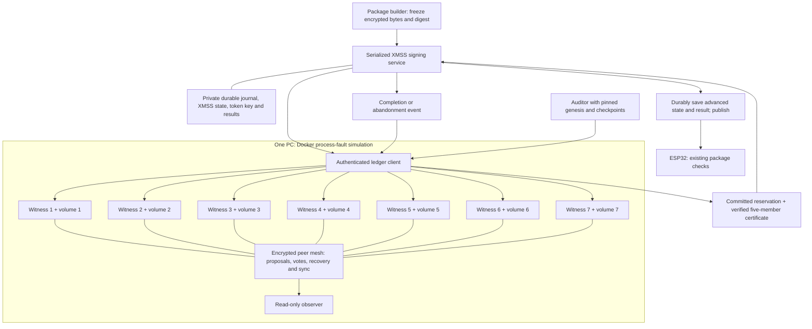

> Historical design/enrollment reference. For current setup, directory layout and operational boundaries, see [the combined architecture](../README.md#complete-architecture) and [setup guide](../README.md#setup-and-operation). Historical version/index observations below are not live status.

# Permissioned witness reservation ledger: architecture v2

Implementation note (25 October 2026): this is the copied design reference. The standalone service is implemented and tested in native mode; see IMPLEMENTATION.md for its actual profile, remaining gates and differences, and reports/VALIDATION.md for evidence. Docker execution remains untested because Docker is absent on this PC.

24 October 2026. Proposed, unimplemented and unmeasured. This is the authoritative ledger extension to ARCHITECTURE.md; BASELINE_ARCHITECTURE.md retains the independent-witness baseline. No Docker services are running as a result of this architecture update. Existing signer, ESP32 and main.tex behavior is unchanged.

## 1. Recommendation and scope

Add the ledger: one event per hash-linked record, replicated across seven witnesses, with five-member finality certificates. No mining, cryptocurrency or monetary tokens. Hash links provide an audit trail relative to a trusted checkpoint; a Byzantine consensus protocol provides agreement; durable signer recovery prevents unsafe re-execution. All three are needed.

Preserve the user's requirement that witness requests carry a stable index hash, not the raw index. The pasted suggestion to send plaintext indices inside encrypted channels is an optional research profile, not the default. Opaque tokens require correct derivation by the trusted signer and cannot independently prove the actual index. The paper currently proposes explicit-index independent reservations; the ledger and token privacy are extensions requiring manuscript disclosure and experiments.

## 2. Deployment and data flow



Each witness runs consensus, deterministic application validation and its own durable storage. No central coordinator counts as multiple voters. Each has a distinct identity/key and private volume; none receives XMSS secrets or K_index. Signer may run on the host, with a client container bridging to the peer network. All signing entry points must eventually route through one signing service.

Docker peer and client networks constrain reachability but do not encrypt traffic. Encrypt client, consensus, synchronization, snapshot and observer connections. Publish only required loopback endpoints. Use non-root users, read-only root filesystems, bounded temporary storage and measured CPU/RAM limits. No Docker socket, host-root mount, shared database or shared writable secret directory in witnesses. Fault-injection privileges belong in a separate test runner.

Seven containers share one OS, administrator, disk and power supply. They simulate process/network faults, not seven independent failure domains. Whole-host compromise or restoration of all volumes can defeat the protection. Independent hardware/administration and external checkpoint retention are future deployment work.

## 3. Trust, quorum and guarantees

n=7, f=2, q=5. Two quorums intersect in at least 2q-n=3 identities, including an honest witness when at most two are malicious. Count unique provisioned identities, not IP addresses or responses. Four signatures do not provide this guarantee.

Safety goals: no conflicting finalized history at one height; no second accepted binding for one publisher/token; no release of reserved capacity after completion or abandonment; no new signing call without finalized reservation and local execution checks. Assumptions include unforgeable authentication, correct randomness and code, persistent consensus safety state at honest nodes, correct token derivation and a controlled serialized signer.

Progress requires the selected protocol's synchrony assumptions and enough connected responsive honest replicas. Five merely online replicas are insufficient if they cannot complete the protocol. No bounded completion is promised during arbitrary delay. Firmware quality, telemetry integrity, malicious use of an extracted XMSS secret and host-wide rollback remain outside these guarantees.

## 4. Genesis, membership and bootstrap

Administrator-authorized canonical genesis specifies format/suite, seven sorted witness identities and ML-DSA public keys, q=5, epoch, authorized clients and publisher registrations. Pin its digest at every client/node through trusted provisioning. Define ledger_id=SHA256(domain||canonical_genesis), excluding ledger_id itself from the genesis encoding. Height starts at 1; the first previous hash is ledger_id.

Publisher registration binds key_id=SHA256(canonical XMSS public key), algorithm/tree capacity, signing identity, token profile and K_commit. Use a fresh unused XMSS key, or import every previously consumed binding through an authenticated migration. A blank ledger cannot reset an existing signing key. With opaque tokens an unverified numeric high-water mark is not sufficient history.

Initial membership is immutable. Epoch change, identity replacement and suite changes are disabled until a safe reconfiguration protocol is selected and tested. Epoch changes never clear consumed tokens. Key exhaustion requires retirement and authenticated provisioning of a new XMSS publisher key. Unknown genesis/epoch or damaged state causes refusal.

## 5. Index privacy and later verification

Provision a separate random 32-byte K_index in the trusted signer, fixed for one XMSS key lifetime:

```
T = HMAC-SHA256(K_index,
    ASCII("WITNESS-IDX-v1") || key_id || BE64(index))
K_commit = SHA256(ASCII("WITNESS-KEY-v1") || key_id || K_index)
```

Send T, not index or K_index. Do not include epoch, request ID or fresh salts in T: they would create new identities for the same index. Plain SHA256(index) permits enumeration of a small domain. Validate range and maintain the private index/token mapping at the signer. Loss of K_index stops this XMSS key; rotation under the same publisher key is forbidden.

Authorized audit can verify K_commit and recompute T from the protected index/key archive. Revealing K_index exposes all mappings, including future indices, so prefer controlled audit or disclosure after retirement. Witness records prove repeated-token detection, not the numeric relationship. Global height, timing and token equality leak activity/order. Standard XMSS signatures themselves expose the index to recipients.

An actively malicious signer can submit two tokens for one index. Neither five signatures nor a hash-linked ledger proves token correctness. Stronger claims require a reviewed proof construction or trusted signing module. An explicit-index encrypted profile enables witness range/uniqueness checks but changes the privacy requirement. Do not claim independent consumer enforcement with opaque tokens alone.

## 6. Deterministic reservation state

```
ABSENT -> RESERVED -> COMPLETED
                  -> ABANDONED
```

Neither terminal state becomes free. No expiry, lease, cancellation, pruning or administrative reset permits reuse. RESERVED consumes allocation capacity even if no signing call occurs.

RESERVE permanently binds publisher/token to package digest, authorized client, operation sequence and request ID. Exact retries return the original result/certificate. Same request ID with changed content is rejected. COMPLETE and ABANDON are separately identified authorized events referencing the reservation hash and repeating its key/token/digest. COMPLETE carries a 32-byte result-bundle hash. ABANDON carries a bounded reason code. Terminal changes are rejected; a completion reported after abandonment is evidence for investigation.

Completion is an authenticated signer report, not proof of physical signing. The result bundle canonically frames signature, publisher, digest and reservation hash; exclude completion hash to avoid circularity. Store exact package/signature separately: a hash alone is not a backup.

Validation must be deterministic: authorization, registration, field lengths, uniqueness, reference and state transition. No wall clock or local health input affects application acceptance. Revalidate against ordered state at execution. Rejected commands/no-ops may consume consensus slots but create no successful ledger record. Consensus sequence and ledger height are distinct.

## 7. Consensus and finality

Use a specified BFT state-machine-replication engine with documented normal operation, prepare/commit rules, view change, checkpointing and crash recovery. A signed PBFT-style engine is the reference family; exact engine/version and feasible post-quantum authentication integration remain implementation gates. A crash-only consensus library is insufficient. Classical-only engine authentication prevents an end-to-end quantum-safe claim.

Conceptual path: signed client command -> leader proposal -> protocol-valid preparation/locking -> protocol-valid five-member commit evidence -> ordered deterministic execution -> durable application commit -> certified response. The signer needs finality evidence and binding to the applied application result, not five arbitrary approvals.

Required engine adapter contract:

- Bind ledger_id, epoch, view, consensus slot and command hash in relevant messages.
- Persist required voting/locking state before effective votes; carry required evidence across view changes.
- Execute committed commands in order and expose protocol-native finality proofs.
- Support authenticated state transfer and fresh reads through a linearizable read/barrier mechanism.
- Preserve safety under duplicate/delayed messages, equivocation, crashes and leader changes.

Prepared conditions, vote counting, lock release and new-view selection must follow the selected engine exactly. This paragraph is an interface contract, not a simplified PBFT replacement. Timeouts trigger view changes, never free reservations. Never select history by longest chain, largest index, wall clock or first five unauthenticated replies. Safety does not depend on synchronized clocks; progress uses engine-specific timeout/backoff assumptions.

Application attestations below are issued only after engine finality and durable execution. Keep engine-native evidence for auditing/recovery. If a reviewed engine-native certificate supplies equivalent application binding, the adapter can avoid redundant attestations, but record that format change explicitly.

## 8. Byte-level application format

Unsigned big-endian integers; raw hash bytes; exact ASCII domains without NUL; no float, ambiguous JSON or implicit padding in signed bytes. Reject unsupported versions, nonzero reserved bytes, malformed length and trailing data. Suite 1 fixes the versioned construction.

Successful record L is 264 bytes:

| Offset | Bytes | Field |
|---|---:|---|
| 0 | 4 | ASCII WLED |
| 4 | 2 | version=2 |
| 6 | 2 | suite=1 |
| 8 | 32 | ledger_id |
| 40 | 8 | membership epoch |
| 48 | 8 | ledger height |
| 56 | 32 | previous successful record hash |
| 88 | 1 | RESERVE=1, COMPLETE=2, ABANDON=3 |
| 89 | 1 | flags=0 |
| 90 | 2 | reason, zero except abandonment |
| 92 | 32 | publisher key_id |
| 124 | 32 | token T |
| 156 | 32 | existing package digest d |
| 188 | 16 | event request ID |
| 204 | 8 | signer operation sequence |
| 212 | 32 | reservation hash; zero for RESERVE |
| 244 | 20 | reserved, zero |

COMPLETE has a required 32-byte result-hash payload; other types have empty payload. Record hash:

```
h = SHA256(ASCII("WITNESS-LEDGER-v2") || L
    || BE32(payload_length) || payload)
```

The predecessor link commits to its payload through h. A trusted later checkpoint detects earlier changes; restoring an old entire chain still requires separate freshness/rollback detection. Do not claim information-theoretic immutability or a blanket 256-bit post-quantum security level.

Signed client command U, 236 bytes, in order: WCMD(4), version(2), suite(2), ledger_id(32), epoch(8), client_id(32), type(1), flags(1), reason(2), key_id(32), T(32), d(32), event_id(16), operation_sequence(8), reservation_reference(32). Sign U||BE32(payload_length)||payload with ML-DSA-65 context WITNESS-CMD-v2. Archive it with the record; derive all event fields from the authenticated command. Leader assigns height/previous hash.

Application attestation A, 136 bytes: WACK(4), version(2), suite(2), ledger_id(32), epoch(8), ledger height(8), consensus view(8), consensus slot(8), record hash(32), witness_id(32). Append ML-DSA-65 signature(3309), context WITNESS-ACK-v2. Five matching attestations share all fields except witness identity/signature; count distinct members only.

Compact application certificate: WQCT(4), version(2), suite(2), L(264), payload_length(4), payload, count(1)=5, five sorted unique (A,signature) entries. RESERVE/ABANDON: 17,502 bytes; COMPLETE: 17,534 bytes. These exclude signed command, engine finality evidence, handshake and TCP/IP. Five independent signatures are not an aggregate/threshold signature. Exact engine proof sizes remain undefined until engine selection; compact application certificate alone is not the engine's commit/view-change proof.

Keep current OTA digest unchanged: SHA256(BE32(version)||BE32(plaintext_size)||BE32(ciphertext_size)||SHA256(ciphertext)||KEM_ciphertext||nonce||tag). The ledger binds d without changing ESP32 package parsing.

## 9. Cryptographic transport

ML-KEM-768 establishes a secret; HKDF-SHA256 derives direction/purpose-specific keys; AES-256-GCM protects records; ML-DSA-65 authenticates clients, peers, votes and attestations. Use maintained libraries, pinned versions, errata review and known-answer tests. ML-KEM sizes: public key 1184, private key 2400, ciphertext 1088, secret 32 bytes. ML-DSA-65 public key is 1952 and signature 3309 bytes.

The baseline's ephemeral authenticated handshake remains a research proposal needing review: initiator signs ephemeral KEM key, challenge, identities and suite; responder signs the full ordered transcript with fresh challenge and encapsulation ciphertext; verify pins, derive transcript-bound directional keys, exchange encrypted Finished messages, erase ephemeral secrets. Review replay, downgrade, reflection, identity binding and forward secrecy. Prefer an applicable reviewed maintained transport meeting the same PQ requirements; do not silently substitute classical authentication.

Full peer mesh has 21 witness pairs. Each pair uses independent secrets and directional nonce spaces, with deterministic witness-ID tie-break for simultaneous connections. Never use one shared group traffic key. Portable vote signatures remain necessary inside encrypted channels.

Frame header: WREC(4), version(2), type(1), flags(1), session_id(16), sequence(8), ciphertext_length(4): 36 visible authenticated bytes. Nonce=direction_prefix(4)||BE64(sequence); append ciphertext and 16-byte GCM tag. Enforce sequence, fresh keys after restart, no wrap, authenticated parsing, bounded lengths and reviewed AEAD usage/rekey limits. Snapshot/finality objects exceeding the record bound use authenticated bounded chunks binding transfer ID, object hash, chunk index and count. Traffic sizes/timing and public handshake material remain visible; compromised endpoints/host can see plaintext.

## 10. Atomic application and consensus storage

Tables: immutable records and commands; reservations keyed uniquely by (key_id,T); idempotency keyed by (client_id,event_id); result reports; certified checkpoints; membership and quarantine metadata. Preserve exact signed bytes and commit linkage.

One application transaction appends the successful record, updates reservation state/idempotency and advances applied consensus slot. Rejections/no-ops still advance applied slot durably. Separate consensus and application journals need an explicit replay contract: committed commands must reapply idempotently after crash. Emit application ACK only after valid engine finality and durable application commit. Persist engine-required safety state before externally effective votes.

SQLite WAL with synchronous=FULL is a candidate application store, not the consensus engine. Test fsync, volume/filesystem semantics, disk-full and torn writes. Container restart does not establish physical durability or anti-rollback protection.

## 11. Checkpoints, catch-up and rollback

Initially checkpoint every 100 successful records, a tunable experiment setting. Canonical state snapshots include all consumed token bindings, terminal states, idempotency and publisher configuration; sort keys and length-frame fields. Bind snapshot hash, ledger height/tip, epoch and engine checkpoint evidence, with five matching checkpoint attestations. Engine pruning/watermarks follow the engine protocol, not the application interval.

Retain a trusted checkpoint lower bound outside the witness set when possible. A same-PC archive shares host risk. A valid old checkpoint cannot prove freshness; use authenticated engine-supported fresh reads/barriers and retained evidence. Snapshot hash alone does not restore data. Retain consumed bindings for the entire publisher-key lifetime even after safe consensus-log pruning.

Rejoining nodes start quarantined. Restore required consensus vote/lock history, validate genesis and checkpoint evidence, replay certified suffix, verify state hash and constraints before voting. Empty state cannot silently reuse a trusted identity. If safe recovery is impossible, stop; identity replacement requires a designed reconfiguration protocol.

A 4/3 partition cannot form a fresh five-member quorum. A connected five-member subset can progress under remaining protocol assumptions. Heal using certified transfer, not arbitrary leader database overwrite. Conflicting valid finality evidence causes halt/quarantine and signed evidence export, never longest-chain selection.

## 12. Signer transaction and conservative restart rule

One serialized service owns XMSS secrets/BDS state. Persist incarnation ID, event ID, operation sequence, selected index and token before submission. Prohibit clones/live-memory snapshot restoration in this controlled lifecycle; a software lease cannot constrain an extracted/cloned signing secret.

Normal operation:

1. Freeze package and d; durably journal candidate and request.
2. Submit signed RESERVE and verify engine finality plus five matching application attestations and command/record binding.
3. Persist certificate. Under signing lock, check actual library index and BDS/TreeHash state match the authorized token; persist signing intent.
4. Call XMSS once. Commit advanced secret state, exact signature, package reference, proof and completed-result marker in one recoverable durable generation.
5. Publish only from that completed generation; queue COMPLETE with result hash and retry reporting idempotently.

Default publication requires reservation finality and durable local result, but does not wait for completion-event finality. Delayed COMPLETE is bookkeeping lag. A stricter publication policy can be evaluated separately. Neither policy publishes before durable state advancement. Existing separate file writes need transactional replacement before this enforcement exists.

On restart obtain an authenticated fresh committed prefix using the engine's supported read/barrier mechanism; one replica's claimed latest height is insufficient. Recover durable generations first. **Never make a new signing call for a reservation from an earlier process incarnation.** Retrieve exact completed bytes if recoverable; otherwise burn the position even if the crash preceded signing intent. RESERVED already blocks reuse while ABANDON reporting is pending.

Opaque tokens prevent a certified numeric high-water lookup. Derive candidate tokens locally and reconcile against fresh committed state; consensus RESERVE is the final duplicate guard. If a candidate already exists, skip safely; an identical old binding never authorizes a new call after restart. Search may be expensive. Use library-supported traversal advancement or validated reconstruction from trusted material; never edit an index counter independently of BDS/TreeHash. Bound recovery work and stop when safe reconstruction or K_index is unavailable.

| Crash point | Required recovery |
|---|---|
| Before known reservation finality | Recover consensus outcome; retry same event ID |
| Committed reservation, reply/certificate lost | Discover record; burn after restart unless completed result exists |
| After certificate, before/during signing | Burn; no new call on old reservation |
| Signing completed, durable generation absent | Burn and move forward safely |
| Durable result exists, COMPLETE absent | Serve exact bytes and retry report |
| After publication | Re-serve stored bytes; no signing |
| All signer/witness volumes rolled back | Outside guarantee unless independent newer evidence survives |

## 13. ESP32 and live observation

V1 ledger stays server-side. Current ESP32 retains publisher pinning, XMSS, version and GCM checks; it does not enforce ledger authorization. AI/rules gating may delay manifest release but cannot override cryptographic checks.

Future consumer enforcement requires provisioned membership, finality verification and binding d to the actual XMSS index. Opaque tokens need an additional verifiable relation; host assertions are insufficient. Measure storage/RAM and streaming verification costs first. Seven ML-DSA-65 public keys alone total 13,664 bytes, before certificates/engine proofs.

Observer shows leader/view, applied consensus slot, ledger height/tip, five-member finality progress, synchronization lag, reservation states, conflicts, latency and CPU/RAM/disk. Provisional states are labeled. Heartbeats are not votes. Redact raw index, K_index, private/session keys and sensitive archive paths. Real-time means measured online processing, not a hard deadline. Backup signer secrets separately from witness history and drill restoration; no admin API frees a token.

## 14. Research evaluation and implementation gates

Compare A local transactional allocator, B independent witnesses (BASELINE_ARCHITECTURE.md), C consensus ledger. Fresh disposable XMSS keys and matched workloads; existing OTA remains a separate baseline. Measure actual calls and indices, consumed allocation, abandoned capacity, finality/conflicts, availability, recovery time, median/p95 authorization latency, throughput, CPU/RAM/disk and complete wire bytes including handshakes/consensus. Derive ground-truth index reuse from controlled signer instrumentation, not token count alone.

Tests must include healthy operation; 1/2/3 unavailable nodes; two equivocal voters; silent/Byzantine leader; leader changes; delayed/duplicate/reordered messages; 4/3 and 5/2 partitions; identical/conflicting concurrent requests; event-ID reuse; stale checkpoints/reads; wrong genesis/epoch; forged/duplicate votes; corrupt hash/payload/reference; AEAD corruption/replay/counter restart; captures on every path; disk-full/torn writes; witness restart/catch-up/pruning; signer crash at every boundary; old backups; empty witness volumes; existing-key bootstrap; token-key loss/rotation attempts; delayed or conflicting terminal reports; exhaustion; unsupported reconfiguration; whole-volume rollback limitation.

Acceptance requires zero reused signing positions in the controlled service, zero conflicting accepted token bindings/final histories, no signing without committed authorization, no reuse after terminal state, and no new call on an old-incarnation reservation. Report availability and capacity loss separately, including failed/incomplete trials. Model-check safety-critical adapter/state-machine logic where practical. Tests are evidence, not a general proof.

Implementation order: canonical codecs/state-machine vectors -> select/pin BFT engine and PQ authentication approach -> seven-container synthetic ledger with durable replay -> reviewed encrypted paths and lifecycle -> transactional XMSS service routing all callers -> observer/checkpoint export/fault experiments -> separate consumer/proof/reconfiguration work.

Open design gates are explicit: exact engine/version and wire proofs; signed genesis/checkpoint/snapshot encodings; chunk framing; AEAD limits; final resource/timeouts; deployment anti-rollback method; stronger token/index proof if required. This architecture does not pretend those choices are implemented or fully specified. The baseline handshake requires review before security claims. No new manuscript results may be reported before experiments.

## 15. Primary sources

- Paper: ../../../output/journal_evidence_update/main.tex, witness proposal and evaluation plan.
- PBFT: https://www.usenix.org/conference/osdi-99/practical-byzantine-fault-tolerance
- ML-KEM/FIPS 203: https://csrc.nist.gov/pubs/fips/203/final
- ML-DSA/FIPS 204: https://csrc.nist.gov/pubs/fips/204/final
- XMSS/RFC 8391: https://www.rfc-editor.org/rfc/rfc8391.html

The ledger design is an application proposal. Hash links, consensus finality, token privacy and signer recovery have distinct assumptions and must be evaluated separately.

